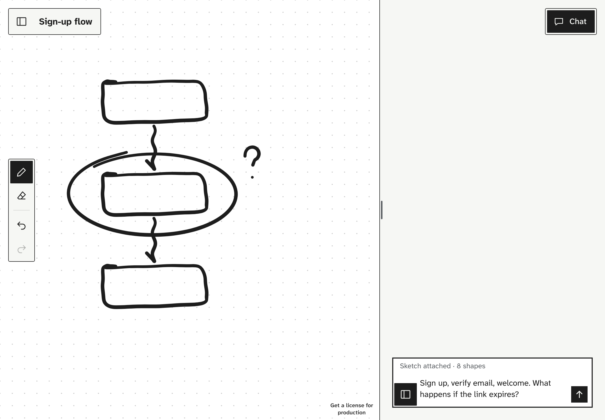

# tldraw-sync

I sketch on an iPad with an Apple Pencil while I work with a coding agent on my Mac. This board lets
the agent see the sketch and draw back on it.



Here I drew sign up, verify email and welcome, then asked what happens if the link expires. The
agent answered in the chat and drew the flow back with a resend path. A message carries only your
words unless you tap the sketch icon beside it. The Mac shows the same board and chat.

## Try it

You need a Mac with [Bun](https://bun.sh) and an iPad that can reach it.

```sh
git clone https://github.com/bout3fiddy/tldraw-sync.git
cd tldraw-sync
bun install
bun link
tldraw-sync start
```

The board opens in a browser on the Mac. Tap the QR icon at the top right, scan it with the iPad
camera and draw.

Any agent that can run commands can look at the drawing: ask it to read `tldraw-sync --help`, and it
will fetch a PNG when you mention your sketch.

To chat on the board, run `/start_whiteboard` in a pih session, scan the QR code on the Mac page
again and leave that page open. In a new session this makes a native board, where you and the agent
edit the same shapes and the iPad's Undo takes back an agent edit. A session that is already linked
keeps the board it has.

## Privacy

The board runs on your Mac and doesn't call a model. It serves plain HTTP with no password, so use
it on a network you trust and don't forward its port. Over Tailscale, the iPad can reach it from
elsewhere if your tailnet allows the port. Anything you send to an agent goes to that agent's model
provider.
