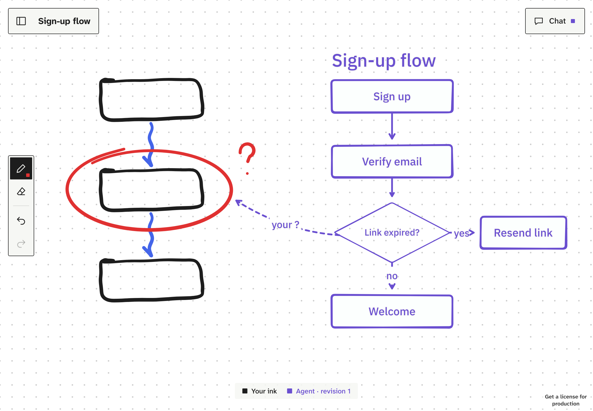
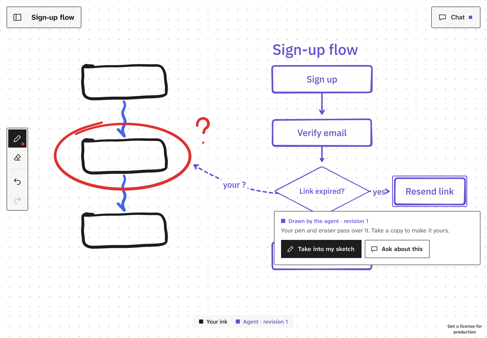
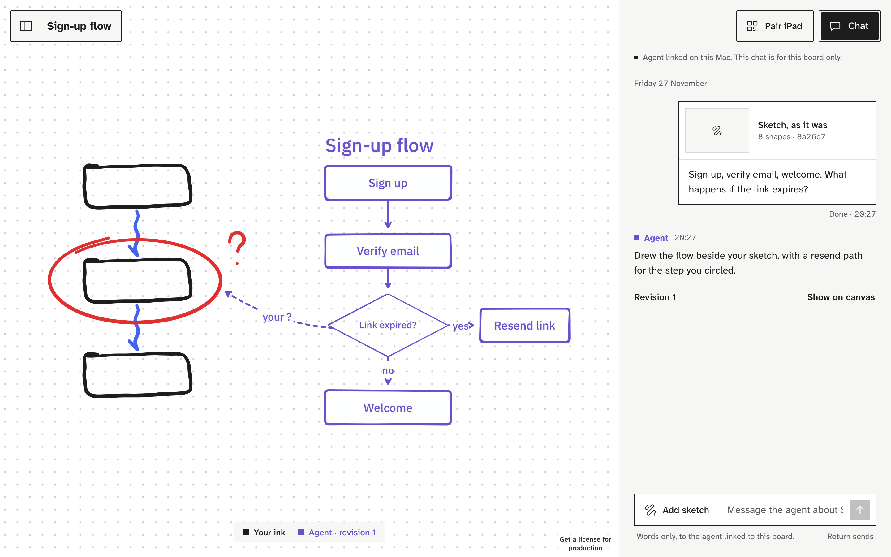

# tldraw-sync

Sketch with an Apple Pencil on your iPad. Your agent answers on the same canvas, in violet.



Your ink stays yours: loose, in black, and exactly as you drew it. The agent draws its answer as
ordinary shapes, printed in violet under your ink, so you can always tell whose line is whose.
Nothing the agent does moves your view or touches your strokes.

## Ask about the board you are drawing


Each board has its own **Chat**. Your words go alone unless you tap the board icon beside the
message. Tap it again to remove the sketch before sending. The agent answers under your message and
draws on the canvas; **Show on canvas** brings its drawing into view.

## Take what helps, in one undo



Tap an agent shape with a finger, or click it, to see whose it is. **Take into my sketch** copies it
into your ink, exactly where it is, as shapes you can edit. One Undo takes the copy back. If the
agent has drawn again or your sketch has changed since you chose the shape, the copy is refused: tap
it again.

The tools float at the left: **Pen**, **Eraser**, **Undo** and **Redo**. Press the pen or eraser you
are holding to put it down and point instead: choose and move your own ink, or tap an agent shape,
with the Pencil too. The pen writes in black; ink drawn in other colours before stays as it was.

The pen and eraser only touch your ink. The key at the foot of the canvas says which revision of the
agent's drawing is shown, and brings **Your ink** or **Agent** into view. When a new revision
arrives the key says so, with the one before it a press away. Looking back restores nothing.

## The whole board on your Mac



The Mac presents the whole board and holds the same chat, so you can keep talking while you look at
the drawing. On the Mac and an iPad held sideways the chat opens beside the canvas, which keeps its
view. Drag the chat’s left edge, or focus it and use the arrow keys, to choose a width for this
device. On a narrow or short screen, or when the keyboard leaves too little room, chat takes the
screen.

## Try it

On a Mac with [Bun](https://bun.sh):

```sh
git clone https://github.com/bout3fiddy/tldraw-sync.git
cd tldraw-sync
bun install
bun link
tldraw-sync start
```

The board opens on your Mac. With your iPad on the same network, scan the QR code and draw. Ask your
agent to read `tldraw-sync --help`; it can then fetch your sketch whenever you mention it.

For Chat, link the board to an agent session: in a pih session with whiteboard support, run
`/start_whiteboard`. Scan the QR code on the Mac stage and leave the stage open. **Chat** at the top
right works on the iPad and the Mac; a violet square on it means an answer you have not read on that
device.

Switch boards with the button beside the board's name, at the top left. A board's **⋮** menu renames
or deletes it; for the board on screen it also clears your ink or replaces it with the agent's
drawing, and Undo takes either back.

## Privacy

The board runs on your Mac and calls no model itself. Use it on a network you trust: sketch access
has no password and traffic is not encrypted. A board's chat is kept on the Mac and can be read only
by the Mac stage and devices paired with that board's QR code. Anything you send to an agent that
uses a hosted model goes to that model's provider.
