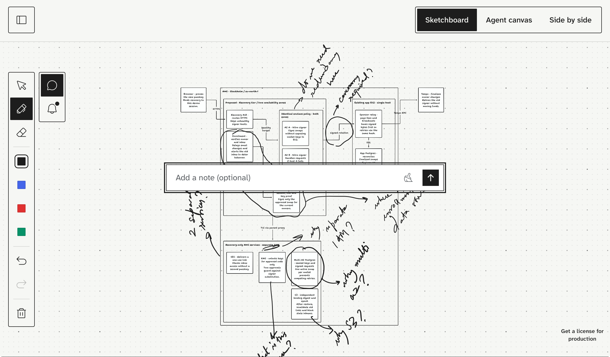

# tldraw-sync

Draw on your iPad with an Apple Pencil while your Mac shows the whole board. Choose **Side by side**
on the Mac to see your Sketchboard next to the Agent canvas.

![Mac screenshot: the Sketchboard on the left shows an architecture diagram with handwritten
questions and circles. The Agent canvas on the right shows the diagram without those marks.][mac]

[mac]: docs/images/whiteboard.png

## Run it locally

On a Mac with [Bun](https://bun.sh) installed, run:

```sh
git clone https://github.com/bout3fiddy/tldraw-sync.git
cd tldraw-sync
bun install
bun link
tldraw-sync start
```

Start opens the board on your Mac. With your iPad on the same network, scan the QR code and draw.
Ask your agent to read `tldraw-sync --help`: it can then fetch your sketch as a picture whenever you
mention it.

Open **Boards** on either device to switch boards. Use a board’s **⋮** menu to rename or delete it.
The home addresses (`/` on the Mac and `/draw` on the iPad) open the oldest remaining board. Delete
all boards and the list stays empty until you select **New board**.

In a pih session with whiteboard support, use `/start_whiteboard` instead to link the board to that
session. Scan the QR code on the Mac stage and leave the stage open. On the iPad, open the note, say
what you want if you like, and send: every send is your sketch as it is, with or without a note. Ask
a question and the agent answers in the conversation. Ask for something drawn, tidied or imagined
and it draws on the **Agent canvas**. **Replace sketchboard** copies that drawing into your sketch
as shapes you can edit, and Undo brings your ink back.

The board runs on your Mac and has no model of its own. Use a trusted network: sketch access has no
password and traffic is unencrypted. If your agent uses a hosted model, the sketch you share with it
goes to that provider.

## iPad Sketchboard

On an iPad in landscape, use the pen palette to annotate a diagram on the Sketchboard.


